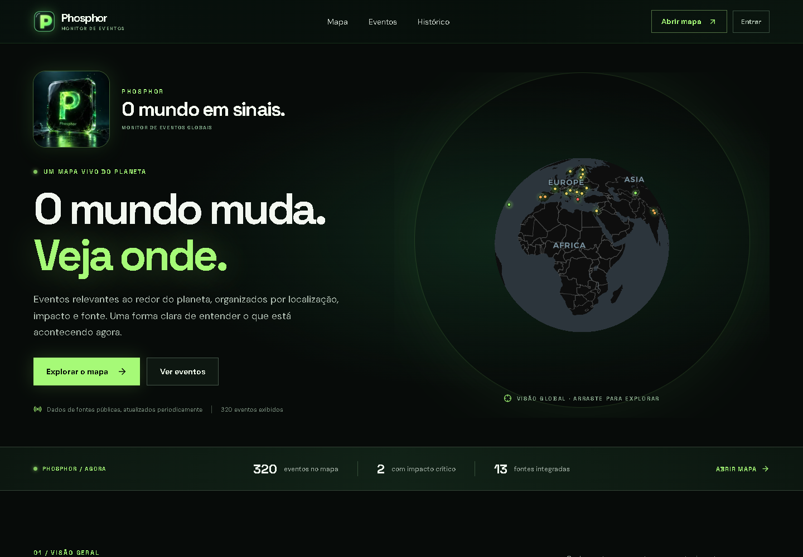
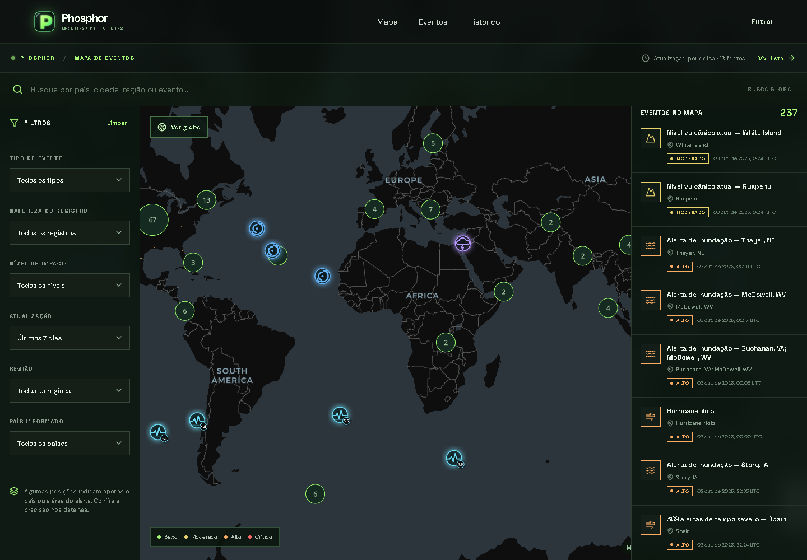

# Phosphor

**O mundo muda. Veja onde.**

Monitor de eventos globais e notícias em um globo interativo. O Phosphor reúne fontes públicas, distingue ocorrências, alertas, observações e relatos jornalísticos, e permite conferir a origem e a precisão geográfica de cada registro.

> Global events and news monitoring, with an interactive globe and transparent source review.





## Funcionalidades

- **Mapa vivo:** globo e mapa plano, ícones por categoria, agrupamento de pontos e áreas oficiais quando disponíveis.
- **Fontes independentes:** 13 provedores públicos; uma falha não interrompe os demais. NASA FIRMS é opcional.
- **Notícias:** descoberta por GDELT e Agência Brasil. CNN, BBC News e Globo/g1 são encontrados pelo índice GDELT, com controles individuais.
- **Localização transparente:** manchetes elegíveis podem aparecer automaticamente. Quando só há um país identificado, a capital serve como referência aproximada, claramente indicada.
- **Revisão humana:** contexto, localização, confirmação adicional, ações em lote, bloqueio, lixeira e restauração.
- **Regras de domínio:** deduplicação, prazos com extensão para consequências graves e triagem de risco com foco em cadeia de suprimentos na América Latina.
- **Entrada contínua:** login sobre a mesma instância do globo, revelação gradual e localização opcional mantida apenas no navegador.
- **Integrações opcionais:** extração assistida por IA, confirmação/recuperação por e-mail, alertas para e-mails verificados e webhooks de Slack/ERP.
- **Acervo histórico:** amostras reais do GDELT a partir de 1979, separadas dos eventos atuais.

Veja [funcionalidades e operação](docs/features.md) para os detalhes.

## Tecnologias

| Camada               | Escolhas                                            |
| -------------------- | --------------------------------------------------- |
| Aplicação            | Next.js 16 App Router, React 19, TypeScript estrito |
| Mapa                 | MapLibre GL JS, mapa base CARTO / OpenStreetMap     |
| Dados                | PostgreSQL, Postgres.js, migrações SQL versionadas  |
| Validação e ingestão | Zod, fast-xml-parser, Cheerio, robots-parser        |
| Qualidade            | Vitest, ESLint, Prettier, GitHub Actions            |

## Rodar localmente

Requisitos: **Node.js 24+**, npm e acesso à internet para mapas e feeds.

```bash
npm ci
npm run dev
```

Abra [localhost:3000](http://localhost:3000). A exploração funciona sem chaves ou banco. Contas, revisões e configurações locais são guardadas em `data/`, ignorado pelo Git. O primeiro acesso a `/admin` permite configurar a conta local **Marcus**, com uma senha de pelo menos 12 caracteres.

Para ativar integrações, copie `.env.example` para `.env.local` e preencha apenas o que for usar. As opções vêm desativadas por padrão. Consulte o [guia de configuração](docs/setup.md).

### Com PostgreSQL

```bash
# Defina DATABASE_URL em .env.local antes deste comando.
npm run db:migrate
npm run dev
```

As migrações são aplicadas uma vez, em transação, e verificadas por checksum. O servidor não cria tabelas durante requisições. Em produção, o armazenamento local é desativado; contas e administração exigem PostgreSQL e segredos próprios.

## Qualidade

```bash
npm run check     # formatação, lint, tipos e testes
npm run build     # compilação de produção
npm run test:watch
npm run format   # aplicar o padrão de formatação
```

Os testes cobrem autenticação, revogação de sessões, origem das requisições, limites de entradas, deduplicação, publicação, prazos e preservação de revisões durante a captura. A integração com PostgreSQL usa exclusivamente um banco `phosphor_test` e roda no GitHub Actions; localmente, precisa de `TEST_DATABASE_URL` e migrações aplicadas. Nenhum teste envia e-mails ou consulta provedores reais.

## Organização

```text
src/
  app/                 rotas, páginas e endpoints
  components/
    admin/             revisão de eventos, notícias e fontes
    auth/              entrada e preferências de alerta
    layout/            navegação e identidade
    map/               globo, marcadores, listas e detalhes
  lib/
    domain/            tipos e regras sem efeitos colaterais
    server/            autenticação, dados, captura e integrações
database/migrations/   esquema PostgreSQL versionado
scripts/               migração, worker do mapa e importação histórica
tests/                 regressões isoladas e integração PostgreSQL
docs/                  arquitetura, configuração e limitações
.github/               CI, atualizações e modelos de contribuição
```

As fronteiras de servidor usam `server-only`: segredos e acesso ao disco não podem entrar no pacote do navegador. Identificadores são escritos em inglês; a interface e a documentação principal estão em português. Comentários explicam decisões e invariantes, como precisão geográfica e preservação de revisões.

## Decisões e limites

- Fontes externas podem atrasar ou falhar. O mapa exibe atualização e links originais; círculos aproximados não são trajetórias oficiais.
- Scores e localização por manchete são heurísticas. Eles não comprovam a veracidade, a ocorrência ou a gravidade do fato.
- Notícias automáticas não disparam alertas externos. Alertas exigem revisão humana e as configurações correspondentes.
- O rastreador direto cobre a Agência Brasil; a cobertura mundial e multilíngue depende do GDELT. Não são copiados corpos nem imagens das matérias.
- O arquivo local é um adaptador de desenvolvimento para **um único processo**. Para múltiplas instâncias, use PostgreSQL.
- A entrega de alertas usa registro de tentativa, sem uma fila durável; uma interrupção entre a reserva e o envio pode exigir recuperação manual.

Leia a [arquitetura](docs/architecture.md), o [guia de configuração](docs/setup.md), as [limitações e fontes](docs/features.md) e a [política de segurança](SECURITY.md).

## Contribuir

Ideias, correções e novos adaptadores são bem-vindos. Antes de abrir um pull request, consulte [CONTRIBUTING.md](CONTRIBUTING.md) e execute as verificações. A inclusão de fontes precisa identificar a origem, validar coordenadas/datas e respeitar as condições do provedor.

## Licença e autoria

Código sob [licença MIT](LICENSE). Dados, mapas, dependências e publicações externas mantêm seus próprios termos; veja [avisos de terceiros](THIRD_PARTY_NOTICES.md).

Projeto de **Marcus Vitorino** — [mlvitorino1](https://github.com/mlvitorino1).
