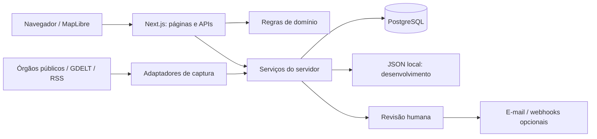

# Arquitetura

## Visão geral

## Fronteiras

`lib/domain` contém tipos, rótulos e funções determinísticas para agrupamento, localização, classificação, prazos e publicação. Essas funções podem ser testadas sem Next.js, disco ou rede.

`lib/server` faz autenticação, persistência e chamadas externas. `server-only` impede a importação desse código por componentes cliente. As respostas de conta usam um DTO público; hash, salt e tokens não são devolvidos à interface.

`app` conecta as rotas aos serviços. Mutações verificam origem, autorização e entrada. Um limite comum transforma falhas inesperadas em uma resposta JSON estável, sem detalhes internos do banco.

## Eventos oficiais

Os adaptadores buscam provedores de forma independente com `Promise.allSettled`, normalizam os resultados em `EventRecord` e validam coordenadas. As consultas têm timeout e cache de cinco minutos. Duplicatas são reunidas por categoria, natureza, tempo, local e, em ciclones, nome reconhecível. O merge copia os arrays; não modifica os objetos do cache.

Na ingestão PostgreSQL, uma lease impede dois processos de executarem o mesmo trabalho simultaneamente. As fontes são consultadas antes da transação; cada atualização de evento e histórico é gravada atomicamente. O ID persistido permanece estável quando uma segunda fonte descreve o mesmo evento.

Eventos encerrados e registros com prazo vencido saem da exploração pública. A administração pode inspecionar registros ocultos. Revisões manuais permanecem em campos de override e sobrevivem à ingestão.

## Notícias

1. Consultas separadas descobrem emergências, cadeia de suprimentos e canais selecionados no GDELT.
2. RSS e uma passagem limitada por páginas da Agência Brasil acrescentam candidatos. O HTML respeita `robots.txt`, o domínio permitido e um limite de páginas; redirecionamentos são recusados.
3. URL canônica, domínio, manchete e período reduzem republicações.
4. Manchetes recentes com sinal de evento e local identificável podem ser publicadas automaticamente. O país do veículo nunca determina o local do evento.
5. Apenas revisões com confirmação adicional são tratadas como publicações revisadas e elegíveis para integrações externas.

O painel é uma leitura: abrir a página não aprova ou altera registros. Na captura local, o estado é relido após a rede e apenas artigos novos são acrescentados, preservando alterações concorrentes. PostgreSQL usa conflitos de chave para preservar registros já existentes. Bloqueios e exclusões são mantidos para impedir recaptura.

Scores são heurísticas de priorização; semelhança de texto não comprova independência editorial. A extração opcional por IA processa somente o trecho colado pelo administrador, valida a resposta estruturada e descarta citações ausentes no trecho. Ela não publica.

## Persistência e concorrência

PostgreSQL guarda eventos, histórico de revisões, candidatos, contas, configurações, limites de requisição e leases. Migrações ordenadas são aplicadas em uma transação com lock e checksum. A conexão de aplicação não precisa criar tabelas.

O JSON de desenvolvimento tem gravação por arquivo temporário e renomeação: leitores não veem um arquivo parcialmente escrito. Atualizações síncronas releem o estado atual. Isso atende um processo local, sem equivaler a um banco compartilhado entre processos.

## Sessões e integrações

Contas usam scrypt assíncrono e cookies assinados com duração limitada. A assinatura inclui a credencial atual, revogando sessões após redefinição de senha. A configuração incompleta em produção falha de forma fechada.

Alertas exigem e-mail confirmado, preferências habilitadas, notícia revisada e risco elegível. Um registro de tentativa reduz duplicatas e é removido após falha detectada. Ainda não há fila durável: uma interrupção após reservar a entrega pode perder uma tentativa. A rotina remove registros antigos de entrega e contadores expirados; retenção de notícias é uma decisão futura, pois apagar bloqueios permitiria recaptura.

## Decisões de escopo

- Um monólito Next.js mantém o portfólio fácil de instalar; adaptadores e regras ficam separados para evolução.
- Migrações SQL explícitas evitam esconder mudanças de esquema atrás de requisições.
- Não há abstração genérica de crawler universal, camada financeira, aprovação por IA nem integração implementada com Defesa Civil brasileira.
- Não há SLA de emergência. O GDELT histórico é uma amostra de eventos codificados, separada do feed atual.
